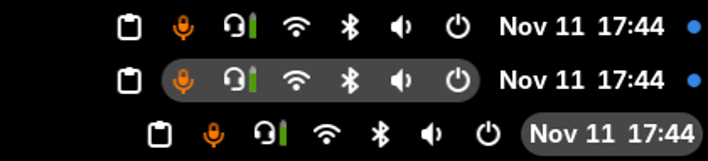
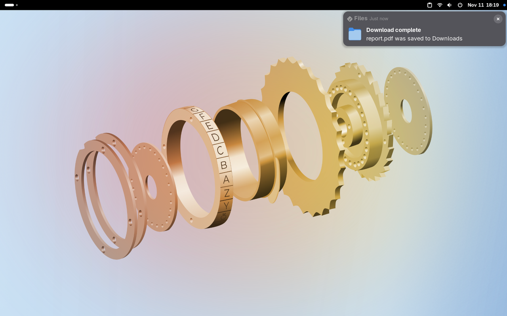
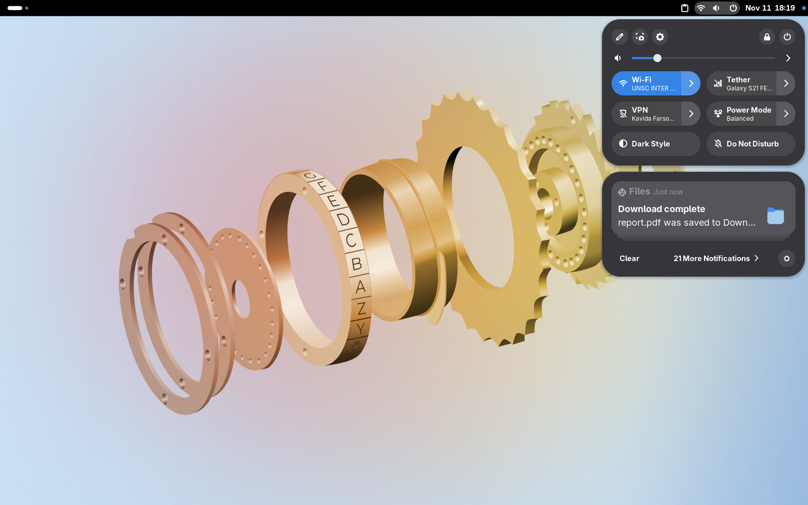
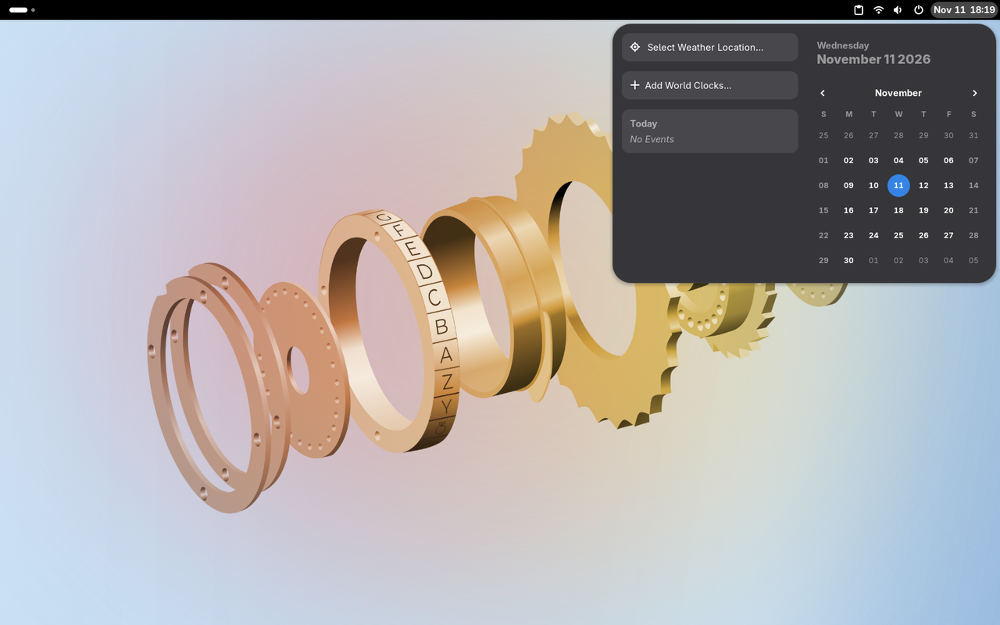
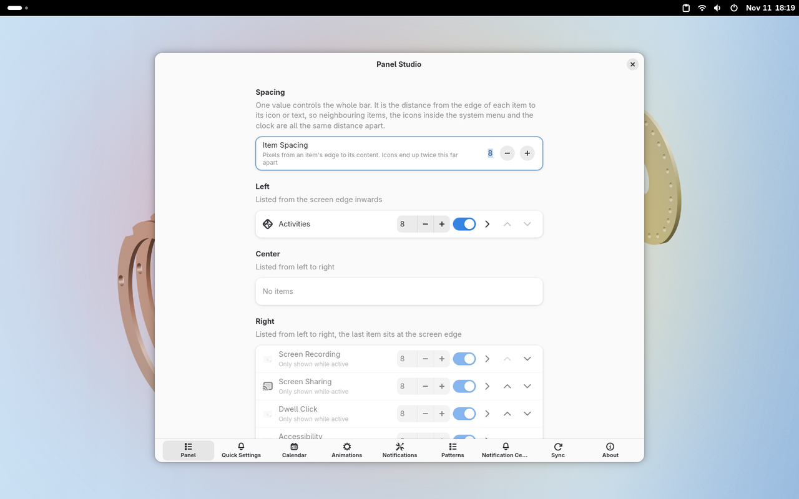

# Panel Studio

One GNOME Shell extension (46–51) that replaces:

| Was | Now |
| --- | --- |
| [Sanket](https://github.com/narkagni/sanket) | `modules/sanket` – notification island, compact Quick Settings, calendar menu |
| [Notification Configurator](https://github.com/ExposedCat/gnome-notification-configurator) | `modules/notifications` – notification position, styling, filtering, notification center |
| [Move Clock](https://github.com/kuvaus/moveclock) | `modules/panel/PanelLayout.js` – any panel item can be moved to any section |
| [Status Area Horizontal Spacing](https://extensions.gnome.org/extension/355/status-area-horizontal-spacing) | `modules/panel/PanelSpacing.js` – padding per item instead of one global value |

Settings keep the original schema IDs for Sanket and Notification Configurator, so existing configuration carries over.

## Panel editor

* Reorder, hide, or move every item (system menu, clock, AppIndicator tray apps, other extensions' indicators) between the left, center and right sections.
* Items listed in the layout are placed in order. Items that appear later (a newly launched tray app) stay where the shell put them.
* Padding can be set per item, so tray icons can sit close together while the system menu and clock keep a comfortable hover area.

## Licence

GPL-3.0-or-later. Vendored code keeps its original copyright headers.

## Screenshots

### Notifications at the top right

### Quick Settings with compact toggles and the notification island

### Calendar menu

### Panel editor in preferences

## Install

* **GNOME Extensions website:** search for *Panel Studio* on [extensions.gnome.org](https://extensions.gnome.org) (once approved).
* **From a release:** download `panel-studio@adhadse.shell-extension.zip` from the [latest release](https://github.com/adhadse/panel-studio/releases/latest), then
  `gnome-extensions install panel-studio@adhadse.shell-extension.zip`, log out and back in, and enable it.

Disable Sanket, Notification Configurator, Move Clock and Status Area Horizontal Spacing first. They patch the same shell objects.

## Releases

Every push to `main` that changes the extension builds a zip, publishes a GitHub release (`v1.<run number>`) and, when enabled, submits it to extensions.gnome.org. See `.github/workflows/release.yml`.
